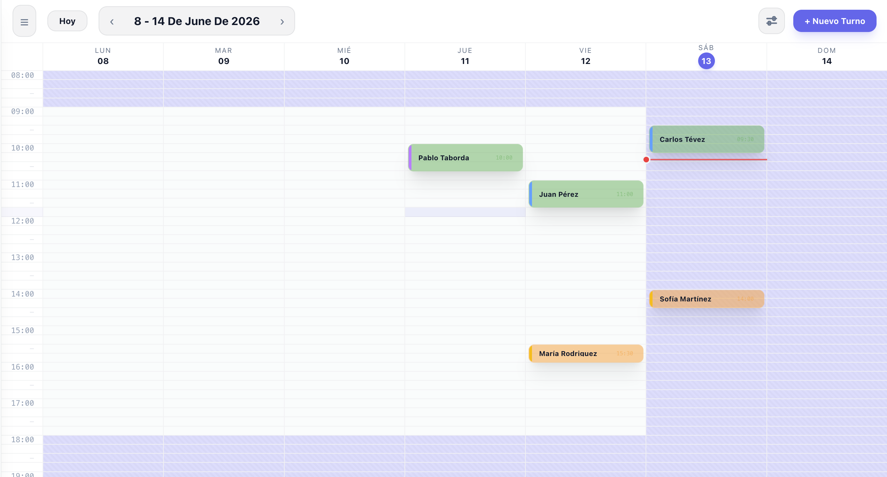

# Axenda

**Appointment scheduling and client management for service businesses.**

Axenda brings calendars, professionals, clients, and services into one workspace. Its multi-tenant structure supports separate businesses and locations, with a booking portal for their customers and a backoffice for platform administration.



*Calendar preview from the application's existing landing-page assets.*

## Features

- Daily and weekly scheduling, with multiple professionals and drag-and-drop rescheduling.
- Client records and appointment history.
- Business locations, professional availability, and service catalogs.
- A public booking portal for customers.
- Responsive interfaces for desktop and mobile.
- Separate business and platform administration applications.

## Technology

| Layer | Tools |
| --- | --- |
| Business interface | Angular, Angular CDK, Tailwind CSS |
| Platform backoffice | Angular |
| API | NestJS, TypeScript |
| Persistence | PostgreSQL, Prisma |
| Supporting services | Redis |
| Delivery | Docker, GitHub Actions |

## Repository structure

```text
frontend/         Business application and customer booking portal
backend/          API, database schema, migrations, and business logic
admin_backoffice/ Platform administration application
```

## Local development

Use a Node.js release supported by Angular 21 (Node 22.12+ is a suitable baseline), npm, and Docker Compose. These commands use the development services, not the production Compose stack.

```sh
npm install
cp backend/.env.example backend/.env
```

Set `DATABASE_URL`, PostgreSQL credentials, and JWT secrets in `backend/.env`. Use the same PostgreSQL credentials for Compose. Configure provider-specific settings for integrations you want to run.

```sh
docker compose --env-file backend/.env -f docker-compose.dev.yml up -d
cd backend
npx prisma generate
npx prisma migrate deploy
cd ..
```

Start the API and business interface in separate terminals:

```sh
npm run start:backend
npm run start:frontend
```

The default development endpoints are `http://localhost:3000/api` and `http://localhost:4200`. To run the platform administration interface, use `npm run start:backoffice`.

The database seed is a separate, optional step. Review `backend/prisma/seed.ts` and administrator creation before using it against any shared environment.

## Build and tests

```sh
npm run build:backend
npm run build:frontend
npm test
```

## Deployment

`docker-compose.yml` and `.github/workflows/deploy.yml` describe the production container setup. Deployment requires environment configuration, registry access, and an existing Docker network. Keep environment files and credentials outside version control.
